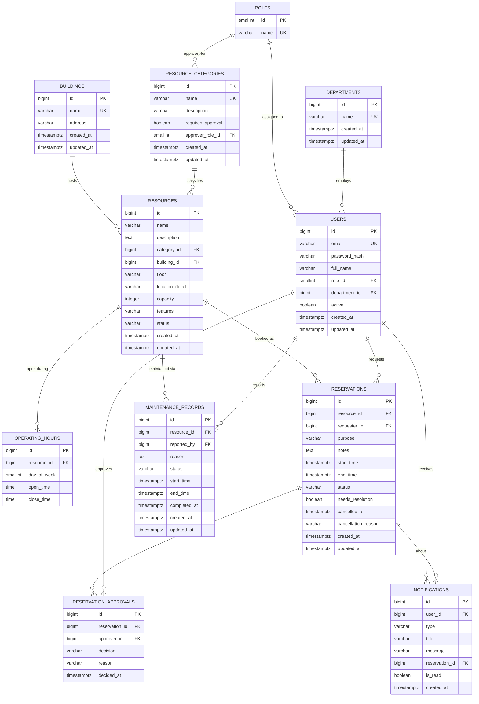

# Entity-Relationship Diagram — FacilityBook

The schema is created entirely through Flyway migrations `V1`–`V11` (seed data in
`V12`–`V13`). There are eleven domain tables.

## 1. Diagram



## 2. Tables

| Table | Purpose | Migration |
| --- | --- | --- |
| `roles` | System roles (seeded with the five roles). | `V1` |
| `departments` | Organisation departments, used for approval routing and reporting. | `V2` |
| `users` | User accounts with role and department references. | `V3` |
| `buildings` | Buildings and locations. | `V4` |
| `resource_categories` | Resource classification **and approval policy**. | `V5` |
| `resources` | Reservable rooms, equipment, vehicles, and other assets. | `V6` |
| `operating_hours` | One open/close window per resource per weekday. | `V7` |
| `reservations` | Booking time range, requester, purpose, and status. | `V8` |
| `reservation_approvals` | Approval decisions with actor, timestamp, and reason. | `V9` |
| `maintenance_records` | Damage reports, scheduled maintenance, and downtime blocks. | `V10` |
| `notifications` | In-app notifications and read status. | `V11` |

## 3. Key relational constraints

**Foreign keys**

- `users.role_id → roles.id` (required), `users.department_id → departments.id` (optional).
- `resources.category_id → resource_categories.id` (required),
  `resources.building_id → buildings.id` (optional — vehicles have no building).
- `operating_hours.resource_id → resources.id` (`ON DELETE CASCADE`).
- `reservations.resource_id → resources.id`, `reservations.requester_id → users.id`.
- `reservation_approvals.reservation_id → reservations.id` (`ON DELETE CASCADE`),
  `reservation_approvals.approver_id → users.id`.
- `maintenance_records.resource_id → resources.id`, `maintenance_records.reported_by → users.id`.
- `notifications.user_id → users.id` (`ON DELETE CASCADE`),
  `notifications.reservation_id → reservations.id` (`ON DELETE SET NULL`).

**Uniqueness**

- `roles.name`, `departments.name`, `buildings.name`, `resource_categories.name`,
  `users.email` are unique.
- `operating_hours (resource_id, day_of_week)` is unique (one window per day).

**Check constraints**

- `resources.capacity > 0` when present; `resources.status IN ('ACTIVE','INACTIVE')`.
- `resource_categories`: `requires_approval = false OR approver_role_id IS NOT NULL`.
- `operating_hours.day_of_week BETWEEN 1 AND 7`; `close_time > open_time`.
- `reservations`: `end_time > start_time`;
  `status IN ('PENDING_APPROVAL','CONFIRMED','REJECTED','CANCELLED')`.
- `reservation_approvals.decision IN ('APPROVED','REJECTED')`.
- `maintenance_records`: `end_time > start_time`;
  `status IN ('REPORTED','SCHEDULED','IN_PROGRESS','COMPLETED','CANCELLED')`.

## 4. Double-booking protection (the critical constraint)

`reservations` carries a PostgreSQL **exclusion constraint**:

```sql
CONSTRAINT no_overlapping_reservations
    EXCLUDE USING gist (
        resource_id WITH =,
        tstzrange(start_time, end_time) WITH &&
    )
    WHERE (status IN ('PENDING_APPROVAL', 'CONFIRMED'))
```

- `tstzrange(start_time, end_time)` is half-open `[start, end)`, so back-to-back
  bookings do not conflict.
- The `WHERE` clause means only active (pending or confirmed) reservations participate;
  cancelled and rejected rows never block a slot.
- `btree_gist` (created in the same migration) lets the index combine `=` on
  `resource_id` with `&&` on the range.
- The service also takes a row lock (`findByIdForUpdate`) around mutating operations,
  and `saveAndFlush` surfaces the constraint violation inside the transaction so a losing
  concurrent request returns an error instead of a false success.

This makes double-booking impossible even if two users submit at the same instant — see
`ReservationConcurrencyTest`.

## 5. How the approval policy is modelled

The approval policy lives on `resource_categories`, not on resources, so it can be
changed for a whole class of resources at once:

| Category | `requires_approval` | `approver_role_id` | Effect |
| --- | --- | --- | --- |
| Meeting Room | `false` | `null` | Auto-confirmed. |
| Training Room | `false` | `null` | Auto-confirmed. |
| Equipment | `false` | `null` | Auto-confirmed. |
| Conference Hall | `true` | `FACILITY_MANAGER` | Facility manager approves. |
| Vehicle | `true` | `DEPARTMENT_MANAGER` | Requester's department manager approves. |

A reservation whose category requires approval is created as `PENDING_APPROVAL`; the
approver role decides who may act, and ADMIN may always act.
